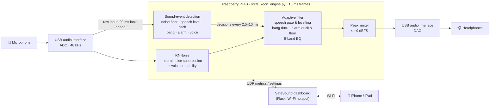
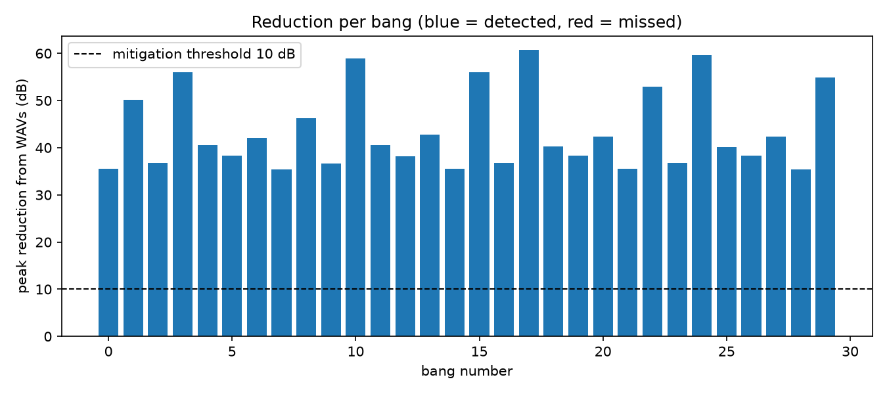
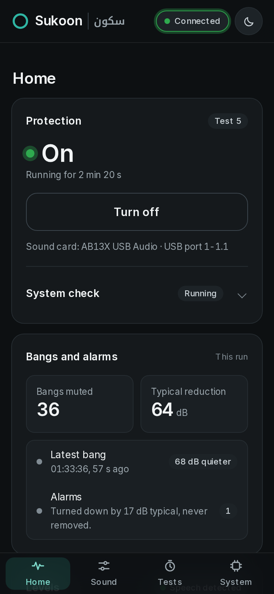
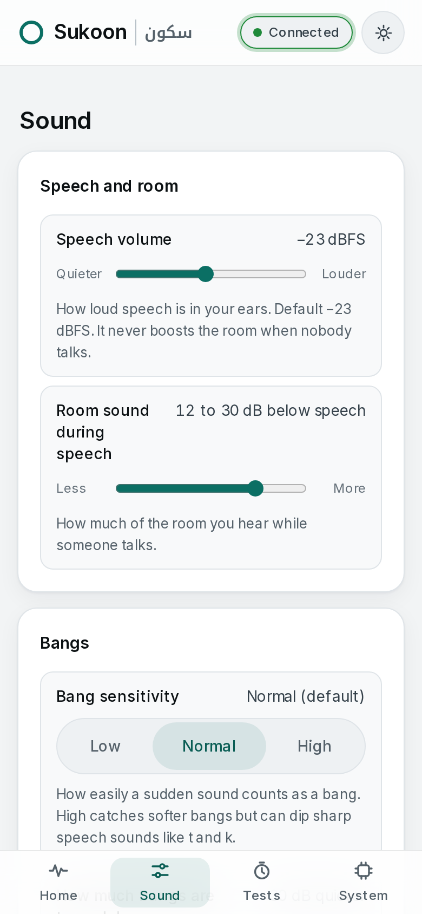
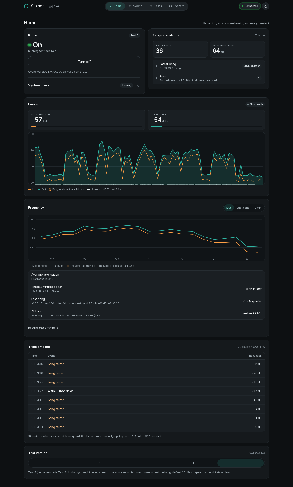

<div align="center">

# Sukoon · سكون

**A wearable, real-time adaptive audio filtering headset that takes the bang out of the world and leaves the voices in.**

Raspberry Pi 4B · RNNoise neural noise suppression · adaptive sound-event detection · iPhone/iPad dashboard

*AUS ELE 491 Senior Design, Group 4 · American University of Sharjah*

</div>

<!-- Hero photo: add docs/images/headset/hero.jpg, then uncomment the next line. -->
<!--  -->
> 📷 **Photo placeholder:** `docs/images/headset/hero.jpg`, the headset as worn.

---

## Overview

Many people are sound-sensitive: autistic people, people with hyperacusis, misophonia or PTSD, and anyone whose nervous system reacts strongly to sudden noise. For them a slammed door, a dropped tray or a clap is not just loud but painful. These sounds cause auditory stress and make ordinary places hard to be in. Ordinary earplugs and noise-cancelling headphones mute everything, including the people the wearer wants to hear and the alarms they need to hear. **Sukoon** (Arabic for *calm, stillness*) is a hear-through headset that listens to the world on the wearer's behalf. A microphone feeds a Raspberry Pi 4B, which processes the sound in 10 ms frames and plays a cleaned version into closed headphones about 70 ms later. Sudden bangs are cut by 25 to 40 dB, speech stays clear and levelled, sirens are turned down but kept audible for safety, and steady background noise is not replayed. It needs no tuning per room, starts by itself when powered on, and can be controlled from an iPhone or iPad.

## Key features

- **Transient protection:** bangs, claps and slams are detected within one 2.5 ms slice and ducked before they reach the ear. A 20 ms look-ahead delay line lets the duck start just ahead of the bang.
- **Speech kept clear:** RNNoise voice probability plus a pitch detector find real, sustained speech. Speech is levelled toward a comfortable target, and bangs during speech are cut without cutting the words around them.
- **Safety-aware alarm handling:** sirens and fire alarms (long, steady, loud sounds) are turned down by about 20 dB but never below an audible floor.
- **No replayed room noise:** RNNoise removes steady background noise (HVAC, hum, crowd bed), and the room is never boosted while nobody is speaking.
- **Hearing safety:** an output peak limiter holds every sample at or below −9 dBFS.
- **Fully adaptive:** it continuously tracks the noise floor, speech level and peaks, so there are no presets to choose per room.
- **Standalone and wearable:** it runs from a 10,000 mAh power bank (7 h 27 min measured), starts at power-up, and restarts itself if the audio process ever fails.
- **SafeSound dashboard:** a web app for iPhone, iPad or laptop served by the headset over its own Wi-Fi hotspot. It needs no internet or app install, and shows live levels, a spectrum, a transients log, all controls and built-in measurement tools.

## How it works



1. **Capture.** The microphone signal is digitised by the USB audio interface at 48 kHz and read in 480-sample (10 ms) frames.
2. **Neural noise suppression.** [RNNoise](https://github.com/xiph/rnnoise), Xiph's recurrent neural network, removes steady noise and reports a per-frame voice probability.
3. **Sound-event detection (the environment classifier).** An adaptive rule-based detector runs alongside the network and works out what is happening in the room:
   - It continuously tracks the noise floor (a 3 s minimum statistic) and the speech level.
   - It checks the last 30 ms for a 70–400 Hz pitch.
   - It labels each moment as **speech**, **bang** (a 2.5 ms slice far above both the speech level and the previous 50 ms), **alarm** (150 ms of steady loud sound at least 20 dB above the room) or **background**.

   It learns as it goes and needs no per-room settings.
4. **Adaptive filter.** The detector drives a time-varying gain network:
   - During speech, a fading "dry" path restores words RNNoise would wrongly remove, and a slow gain levels the speech.
   - A bang ducks the whole output by 30 dB for 30–300 ms, starting one slice early thanks to the delay line.
   - An alarm is played as the real sound, turned down by about 20 dB and held above an audible floor.
   - In silence, the room is not boosted.

   A 5-band equaliser can restore crispness the microphone loses.
5. **Protect and play.** A per-sample peak limiter (instant attack, 50 ms release) caps the output at −9 dBFS before the DAC.

The processing stage is selectable as **Test versions 1 to 5** from the dashboard. Each adds one capability to the one before (sustained-voice rule, alarm guard, audible-alarm floor, bang ducking during speech). **Test 5 is the default and contains all of them.** The other versions stay available for comparison and demonstration.

## Hardware

| Component | Part | Role |
|---|---|---|
| Processor | **Raspberry Pi 4 Model B**, 4 GB RAM (Rev 1.4) | Runs the audio engine, the dashboard and the Wi-Fi hotspot. CPU fixed at 1.8 GHz (performance governor) |
| Storage | **64 GB microSD card** | Raspberry Pi OS (64-bit, Debian 13), software and test recordings |
| Audio interface (ADC/DAC) | **ESSAGER USB audio adapter** (AB13X chip USB ID `0020:0b21`), with separate mic and headphone 3.5 mm jacks | Digitises the microphone and drives the headphones at 48 kHz. Usable bandwidth about 7.5–8 kHz. A second adapter (`1620:0b21`) is also recognised |
| Headphones / earcups | **DIY 3D-printed closed-back headphones** built from the open-source [Ouroboros](https://github.com/CapraAudio/Ouroboros) design by Capra Audio, **3.5 mm** connector version: 60 mm 32 Ω drivers, Yaxi pads, housings and headband printed in **PETG**, gaskets in **TPU 95A**, 1.25 m cable | Deliver the processed sound. The closed back and pads give passive isolation, so the processed signal dominates |
| Microphone | **NEEWER lavalier lapel microphone** (omnidirectional condenser, wired, clip-on), 3.5 mm plug into the adapter's mic jack. Separate wire from the headphone cable; clips onto the cable or the wearer's clothing | Picks up the surroundings for processing |
| Power | **Generic 10,000 mAh USB power bank** + USB-C cable | Powers the Pi and the adapter. 7 h 27 min measured on one charge |
| Enclosure / mounting | Raspberry Pi in a black ventilated case with a 5 V cooling fan, stacked on top of the power bank as one compact unit; 15 cm right-angle USB-C cable between them. Headphones 3D-printed (PETG, TPU 95A) | Wearable assembly |
| Remote control | Any iPhone, iPad or laptop with a browser | Opens the dashboard over the Pi's hotspot |

Full bill of materials, wiring diagram and assembly notes: **[hardware/](hardware/)**.

<!-- Add the photos, then uncomment:


-->
> 📷 **Photo placeholders:** `docs/images/headset/headset_front.jpg`, `docs/images/headset/headset_side.jpg`, `docs/images/headset/electronics.jpg`, `docs/images/headset/wiring.jpg`, `docs/images/headset/in_use.jpg`

## Performance

Measured on the Raspberry Pi 4B with the AB13X adapter, Test 5, Standard buffer (40 ms device buffers), mic level 80%.

**Headline: under 100 ms latency (72 ms typical) with 25–40 dB median transient reduction.**

| Quantity | Result |
|---|---|
| Latency, microphone to ear | **72 ms typical**, 64–83 ms across measurements. This includes the 20 ms algorithm delay (look-ahead) and the USB audio buffers |
| Transient reduction, −2.8 dBFS bangs | 30/30 detected and reduced. **Median 40.4 dB** peak reduction (lowest 35.4 dB, highest 60.7 dB) |
| Transient reduction, −12 dBFS bangs | 30/30 detected and reduced. **Median 25.4 dB** peak reduction (lowest 22.1 dB) |
| False triggers | 1 per 5-minute test |
| Output peak | Never above −9.0 dBFS (limiter ceiling) |
| Battery life | **7 h 27 min** on a 10,000 mAh power bank (overnight, continuous processing) |
| Processing load | 5.5 ms mean per 10 ms frame (worst 9.8 ms); about 20% of the four cores |
| Temperature | 45–50 °C over 7 h (no throttling, no under-voltage) |
| Dropouts | 0 output underflows in 7 h 27 min standalone |

Method for the bang results: a real bang recorded with the headset microphone was repeated 30 times, 8 s apart, over a recorded room-noise bed, and fed into the live pipeline input. This means the input could not clip, so the numbers measure the processing, not the room acoustics. Passive isolation of the earcups comes on top of these figures. Data and figures: **[docs/results/](docs/results/)**.

<p align="center"></p>

## Setup

You need a Raspberry Pi 4B with a fresh **Raspberry Pi OS (64-bit)** on the microSD card, the USB audio adapter, the headphones and microphone, and internet access for the one-time install.

```bash
# 1. Get the code onto the Pi
git clone https://github.com/alrefaei-9/sukoon.git ~/sukoon
cd ~/sukoon

# 2. Configure the hotspot (name, password, Wi-Fi country) and hostname
cp system/config.example system/config.env
nano system/config.env            # set HOTSPOT_PASSWORD (8-63 characters)

# 3. Install (about 5 minutes): packages, Python environment, RNNoise build, hotspot, services
sudo ./system/install.sh

# 4. Power off, plug the USB audio adapter in, power on
sudo poweroff
```

`install.sh` installs the system packages, creates `.venv` from the pinned `requirements.txt`, and builds RNNoise from its pinned, SHA-256-checked source (see [models/](models/)). It then creates the Wi-Fi hotspot and the `sukoon.local` name, and enables the `sukoon` and `sukoon-governor` systemd services, so the headset starts by itself at every power-up. Run it again at any time; it is safe to repeat. Options: `--skip-hotspot`, `--rebuild-rnnoise`, `--no-start`.

> **Note:** plug the USB audio adapter in or out only while the Pi is powered off. The adapter is detected once, at power-up, by its USB ID.

## Usage

1. **Power on.** Connect the power bank. About 90 seconds later you hear a short spoken welcome in the headphones, then the room, processed. Sukoon is on; no phone is needed.
2. **Check it.** Clap once: the clap should be far quieter in the headphones than in the room, while voices stay clear.
3. **Control it (optional).** Open the dashboard (below).
4. **Shut down safely.** On the Pi, run `sudo poweroff`, wait for the green LED to stop, then unplug the power bank.

Running the engine by hand (for development, with the service stopped): `.venv/bin/python src/sukoon_engine.py` runs live in Test 5. `SUKOON_DEVICE=hw:1,0` picks the card and `SUKOON_TEST_VERSION=1..5` picks the version.

Step-by-step guide and troubleshooting: **[docs/user-guide.md](docs/user-guide.md)**.

## The SafeSound dashboard

1. On the iPhone or iPad, join the Wi-Fi network set in `config.env` (default **Sukoon**).
2. Open **http://sukoon.local:5000** in Safari (fallback: `http://10.42.0.1:5000`, the standard hotspot address).
3. Optional: Share → *Add to Home Screen* to open it like an app.

<p align="center">
  
  &nbsp;
  
</p>

| Tab | What it does |
|---|---|
| **Home** | Protection On/Off, the system check (sound card, microphone, headphones), bangs muted and the typical reduction, live input-vs-output levels, the frequency spectrum (live, last bang, 3-minute average), the transients log, and the test version (5 by default) |
| **Sound** | Speech volume, room sound during speech, bang sensitivity and depth, alarm reduction, tone presets and 5-band EQ, microphone level, A/B compare with the raw microphone, saved presets, reset |
| **Tests** | Timed test (1–5 minutes): records input and output with per-band levels, CPU, temperature and every bang, then downloads as one zip. Also recording playback through the pipeline, a battery test and a guided passive-attenuation test |
| **System** | Active sound card and USB port, Pi health (power, CPU, temperature, clock), latency measurement, processing time per frame, attenuation summary, storage |



Full control reference: **[docs/dashboard.md](docs/dashboard.md)**.

## Repository layout

```
src/            sukoon_engine.py  audio engine: RNNoise wrapper, sound-event detection, adaptive filter, limiter
                build_rnnoise.py  builds RNNoise from pinned, SHA-256-checked source
dashboard/      server.py         SafeSound dashboard (Flask): system check, power, settings, measurements
                soundcards.py     USB audio adapter detection by USB ID
                audio_check.py    microphone check, test sound, latency measurement
                static/           the web app (single page, offline fonts)
                sounds/           welcome voice, ready chime, headphone test prompt
tools/          recorders and analysis used by the Tests tab (shared-memory tap, timed, battery, passive tests)
models/         about the RNNoise neural network model and how it is obtained
system/         install.sh, systemd services, config.example
hardware/       bill of materials, wiring diagram, assembly notes
docs/           user guide, dashboard reference, results data, images
```

## Team

- **Ahmad Al-Refaei**
- **Noof Alzarooni**
- **Salsabeel Elsharkawy**

**Advisors:** Dr. Hasan Mir and Dr. Lutfi Albasha, Department of Electrical Engineering, American University of Sharjah.

## Acknowledgments

- Our advisors, **Dr. Hasan Mir** and **Dr. Lutfi Albasha**, for their guidance throughout the project.
- The Department of Electrical Engineering at the **American University of Sharjah**.
- **Xiph.Org** and Jean-Marc Valin for [RNNoise](https://github.com/xiph/rnnoise) (BSD-3-Clause).
- **Capra Audio** for the open-source [Ouroboros](https://github.com/CapraAudio/Ouroboros) headphone design (CC BY-NC-ND 4.0; design files not redistributed here).
- The [Piper](https://github.com/OHF-Voice/piper1-gpl) text-to-speech project, used to generate the spoken prompts.
- The [Inter](https://github.com/rsms/inter) and [Noto Kufi Arabic](https://github.com/notofonts/arabic) typefaces (SIL OFL 1.1).

## License

Sukoon's code and documentation are released under the [MIT License](LICENSE). Third-party components keep their own licences: see [THIRD_PARTY_NOTICES.md](THIRD_PARTY_NOTICES.md). The Ouroboros headphone design is licensed separately by Capra Audio and is not covered by this repository's licence.

> Sukoon is a student engineering project, not a medical device. It is not intended to diagnose, treat or prevent any condition, and it does not replace certified hearing protection.
