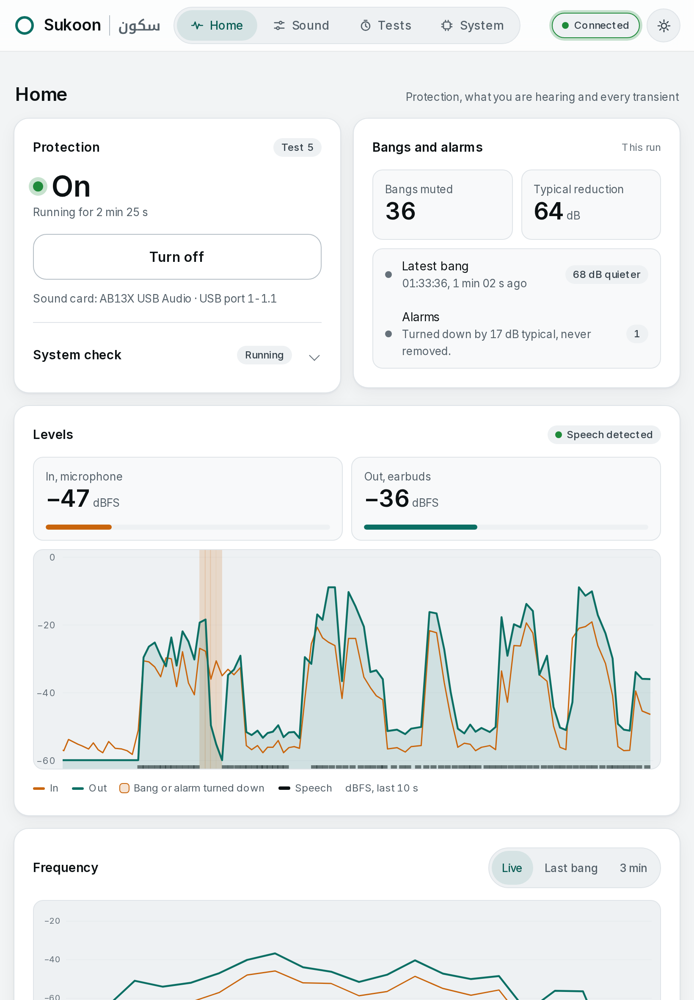

# Sukoon user guide

Words used here: the **Pi** is the Raspberry Pi 4B that does the processing. The **dashboard** is the SafeSound web page the Pi serves. The **hotspot** is the Wi-Fi network the Pi creates. **dBFS** is a level relative to the loudest value the sound card can represent (0 dBFS); quieter levels are negative.

## 1. Hardware setup

You need the Pi with Sukoon installed (see the README), the USB audio adapter, the headphones, the microphone, and a charged power bank with its cable.

1. Make sure the Pi is **powered off**.
2. Plug the USB audio adapter into any USB port of the Pi.
3. Plug the microphone into the adapter's mic jack and the headphones into its headphone jack.

> **Rule:** plug the adapter in or out only while the Pi is powered off. It is detected once, at power-up, by its USB ID. Changing it while the Pi is on leaves Sukoon without sound until the next power-up.

## 2. Powering on

1. Put the headphones on.
2. Connect the power bank to the Pi's USB-C power socket.
3. Wait about 90 seconds. You hear a short spoken welcome, then the room through the headphones with a small delay. Sukoon is on; no phone is needed.
4. Clap once. The clap should sound much quieter in the headphones than in the room, while voices stay clear.

## 3. Opening the dashboard

1. On the iPhone, iPad or laptop, join the Wi-Fi network named in `system/config.env` (default **Sukoon**). Your device may warn that the network has no internet; stay connected.
2. Open **http://sukoon.local:5000** (or `http://10.42.0.1:5000`). Use `http://`, not `https://`.
3. On iPhone or iPad: Share → *Add to Home Screen* to open it like an app.

The tabs and every control are described in [dashboard.md](dashboard.md).

## 4. Turning protection off and on

- **Turn off / Turn on** is the large button on Home. Off means the headphones are silent; you hear only what passes the earcups.
- Sukoon turns itself on at every power-up. You need the button only to stop it (for example before a latency measurement) and to start it again.
- Turning on needs the sound card and the microphone check to pass. The headphone check is optional.
- If the audio process stops or hangs, the dashboard restarts it within seconds (at most three times in ten minutes).

## 5. Measuring latency

1. On Home, tap **Turn off**.
2. Wear the headphones as usual. Keep the room quiet.
3. Open **System › Latency** and tap **Measure latency**. You hear ten soft sweeps for about 5 seconds.
4. Repeat three to five times; results vary by about 10 ms. Typical result: about 72 ms.
5. Go back to Home and tap **Turn on**.

## 6. Running a timed test

With Sukoon on, open **Tests › Timed test**, choose 1 to 5 minutes and tap **Start test**. Sukoon records the microphone and the output and logs levels per band, CPU, temperature and every bang. When it finishes, download the zip from **Saved tests**.

## 7. Safe shutdown

Pulling the power while the Pi writes can damage the SD card.

1. Connect with SSH and run `sudo poweroff`.
2. Wait until the Pi's green LED stops blinking (about 15 seconds).
3. Unplug the power bank.

If the power bank runs empty, the Pi normally starts again without trouble; a test that was running is marked "interrupted" and keeps its data.

## 8. Good practice

- Start with a fully charged power bank (one charge lasted 7 h 27 min).
- Do not run other programs on the Pi while Sukoon is in use; they can cause short dropouts.
- A level of **0 dBFS** at the microphone means the input is clipping. Lower the mic level (Sound › Microphone) or move the sound source away.

## 9. Troubleshooting

| Problem | What to check |
|---|---|
| **No sound in the headphones** | Home: is Protection **On**? If Off, read the message under the button and tap Turn on. Home › System check: are the sound card and microphone ticked? Are the plugs fully in? On the Pi: `systemctl status sukoon` and the end of `dashboard/pipeline.log` |
| **Dashboard does not load** | Is your device still on the Sukoon hotspot (phones often jump back to another network)? Try `http://10.42.0.1:5000`. Wait 90 seconds after power-up. On the Pi: `systemctl status sukoon` should say "active (running)"; logs: `journalctl -u sukoon -b` |
| **Sound card not detected** | System › Sound card shows "Not found". Power off, plug the adapter in firmly (try another USB port), power on. Only supported adapters are accepted (see `dashboard/soundcards.py`) |
| **Under-voltage** | System › Raspberry Pi › Power supply shows a warning. Use a short, thick cable and a power bank rated for at least 3 A, and unplug other USB devices |
| **Clicks or short gaps** | System › Processing: are "Output underflows" rising? Close other programs or SSH sessions running on the Pi, and check the temperature |
| **Disconnected banner** | The page lost contact with the Pi. It reconnects by itself; Sukoon keeps running without the dashboard |
| **Loud claps sound harsh** | The microphone is clipping. Sound › Microphone: lower the mic level until "Clipped samples, last 10 s" stays at 0 |

## 10. For developers

- Engine by hand (stop the service first: `sudo systemctl stop sukoon`): `.venv/bin/python src/sukoon_engine.py`. Environment overrides: `SUKOON_DEVICE=hw:1,0`, `SUKOON_TEST_VERSION=1..5` (default 5), `SUKOON_NO_RECORD=1`.
- Dashboard by hand: `.venv/bin/python dashboard/server.py` (port `SUKOON_HTTP_PORT`, default 5000).
- The engine sends metrics to the dashboard on UDP 127.0.0.1:5005 and receives settings on 5006. The Tests-tab recorders read its shared-memory tap at `/dev/shm/sukoon_tap`.
- Never block the audio loop: nothing slow or I/O-bound belongs in `process_frame()` or the real-time loop.
- To force a particular sound card, copy `dashboard/soundcard.json.example` to `dashboard/soundcard.json`.
