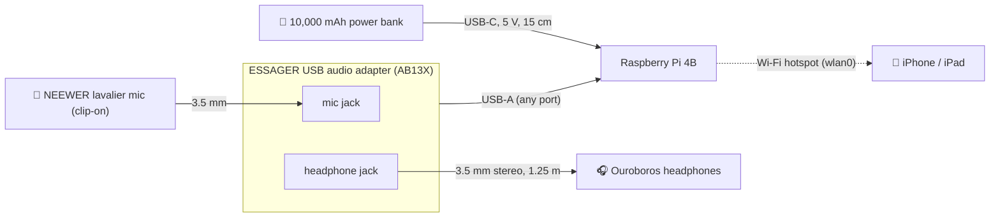

# Wiring and connections

Sukoon needs no soldering on the Pi. Audio and power connect through standard USB and 3.5 mm plugs; the only GPIO connection is the case fan (5 V and GND pins).



```
 ┌──────────────┐  USB-C 5 V   ┌──────────────────────┐   USB-A   ┌───────────────────────┐
 │  Power bank  │─────────────▶│  Raspberry Pi 4B     │◀──────────│  AB13X USB audio      │
 │  10,000 mAh  │              │  (microSD 64 GB)     │           │  adapter              │
 └──────────────┘              │                      │           │   mic jack ◀──────────┼── 3.5 mm ── Microphone
                               │  wlan0 hotspot ))) ──┼── Wi-Fi ─▶│   headphone jack ─────┼── 3.5 mm ──▶ Headphones
                               └──────────────────────┘  iPhone   └───────────────────────┘
```

| From | To | Cable / link | Notes |
|---|---|---|---|
| Power bank | Pi USB-C power input | USB-C, 15 cm, right-angle | Short, thick cable. Under-voltage shows on the dashboard (System › Raspberry Pi) |
| USB audio adapter | Any Pi USB port | Adapter's own USB-A plug | Plug in or out **only with the Pi powered off**: the adapter is detected once at power-up, by USB ID |
| Lavalier microphone | Adapter mic jack | Its own 3.5 mm wire | Clipped to the headphone cable or clothing. Mic level is set from the dashboard (default 80%) |
| Headphones | Adapter headphone jack | 3.5 mm stereo, 1.25 m | Output limited to −9 dBFS |
| iPhone / iPad | Pi | Wi-Fi (hotspot from `config.env`) | Dashboard at `http://sukoon.local:5000` |

Signal path in software: microphone → adapter ADC (48 kHz) → `src/sukoon_engine.py` (RNNoise → sound-event detection → adaptive filter → limiter) → adapter DAC → headphones.

> 📷 Add a photo of the real connections as `docs/images/headset/wiring.jpg`.
